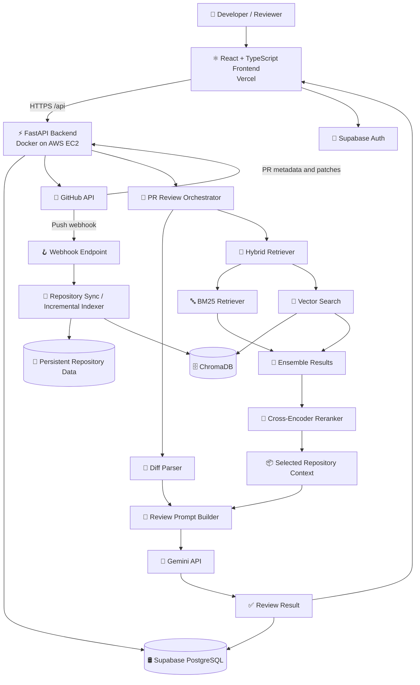
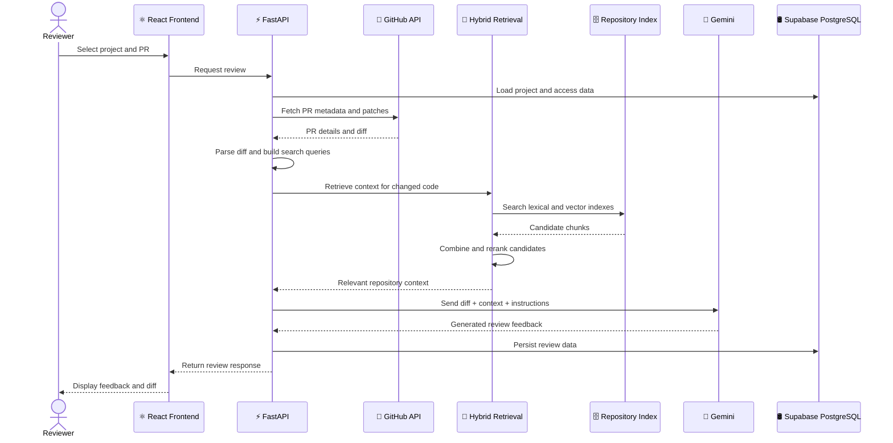
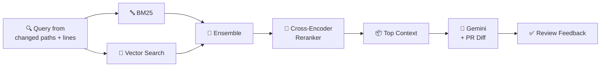
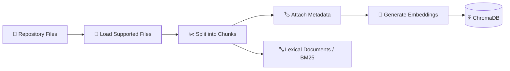
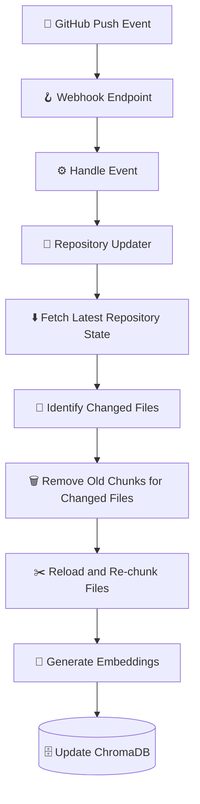
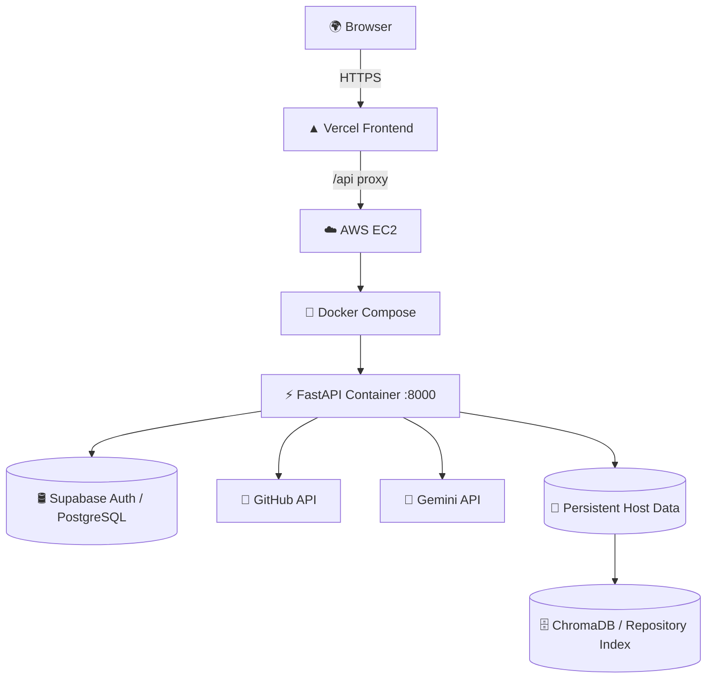

<div align="center">


# RepoVela

### AI-powered, repository-aware code reviews for GitHub Pull Requests

*Hybrid RAG (BM25 + Vector Search) · Cross-Encoder Reranking · Gemini-powered review generation*

<br/>


<br/>

[✨ Features](#-features) •
[🏗️ Architecture](#️-architecture) •
[🔄 Workflow](#-pr-review-workflow) •
[🧠 RAG Pipeline](#-hybrid-rag-pipeline) •
[🚀 Getting Started](#-local-development) •
[🔐 Security](#-security-and-privacy)

</div>

---

> [!NOTE]
> **Status:** The frontend is deployed on **Vercel** and the FastAPI backend runs in **Docker on AWS EC2**.
> This document describes the architecture and implementation. Performance, accuracy, security guarantees and scale
> should only be claimed after they have been **measured or verified** in the deployed application.

---

## 📑 Table of Contents

<details>
<summary>Click to expand</summary>

1. [Overview](#-overview)
2. [Problem Statement](#-problem-statement)
3. [Solution](#-solution)
4. [Features](#-features)
5. [Technology Stack](#-technology-stack)
6. [Architecture](#️-architecture)
7. [PR Review Workflow](#-pr-review-workflow)
8. [Hybrid RAG Pipeline](#-hybrid-rag-pipeline)
9. [Repository Indexing & Synchronization](#-repository-indexing--synchronization)
10. [Security & Privacy](#-security-and-privacy)
11. [Deployment](#-deployment)
12. [Configuration](#️-configuration)
13. [Local Development](#-local-development)
14. [Operations & Troubleshooting](#-operations-and-troubleshooting)
15. [API Overview](#-api-overview)
16. [Limitations](#️-limitations)
17. [Roadmap](#️-roadmap)
18. [Contributing](#-contributing)
19. [License](#-license)

</details>

---

## 📖 Overview

**RepoVela** is a full-stack application that helps developers review GitHub Pull Requests using the **changed code**
*and* **relevant context retrieved from the surrounding repository**. It combines:

| 🔎 Hybrid Retrieval | 🧬 Ensemble | 🎯 Reranking | ✍️ Generation |
|:---:|:---:|:---:|:---:|
| BM25 + Vector Search | Merge lexical & semantic candidates | Cross-encoder relevance ordering | Gemini review feedback |

---

## ❗ Problem Statement

Code review catches defects, improves maintainability and spreads engineering knowledge. But a reviewer needs to
understand **more than the changed lines**.

| Challenge | Description |
|---|---|
| 🧩 **Missing context** | A diff rarely explains dependencies, conventions, helper functions and related modules. |
| ⏱️ **Review overhead** | Developers repeatedly check edge cases, error handling, security risks and maintainability. |
| 📚 **Large repositories** | Finding the right surrounding code manually gets harder as a project grows. |
| ⚖️ **Inconsistent depth** | Feedback varies with reviewer availability, experience and codebase familiarity. |
| 🕰️ **Stale context** | A repository-aware system must keep its index synchronized with repository changes. |

Sending **only a diff** to an LLM may omit important project context. Sending the **entire repository** is expensive,
can exceed model context limits, and exposes more source code than a review needs.

---

## 💡 Solution

RepoVela implements a **repository-aware Retrieval-Augmented Generation (RAG)** workflow. It retrieves relevant code
chunks for a PR's changed files, combines lexical and semantic search, reranks candidates, and supplies the selected context
together with the PR diff to Gemini.

> [!IMPORTANT]
> The system is designed to **assist** a human reviewer by highlighting potential issues and providing a useful starting point.
> It does **not** guarantee that code is correct or secure, and does not replace human review, tests, static analysis or security tooling.

### 🎯 Design Goals

- ✅ Ground review feedback in the diff and relevant repository code
- ✅ Combine exact-term search with semantic retrieval
- ✅ Rerank candidates before sending context to the model
- ✅ Persist repository/index data across container recreation
- ✅ Support incremental indexing of changed files
- ✅ Offer a web interface for projects, PRs, diffs and review results
- ✅ Apply authentication and backend security controls to protected APIs

---

## ✨ Features

### 🔍 Repository-Aware Pull Request Review
- 📥 Retrieves PR metadata and changed-file patches via GitHub integration
- 🧾 Parses diffs into structured inputs
- 🧠 Builds retrieval queries from file paths and added/removed lines
- 🤖 Sends the diff and selected repository context to Gemini
- 📤 Returns review feedback to the frontend

### 🧲 Hybrid Retrieval

| Component | Purpose |
|---|---|
| 🔤 **BM25** | Lexical search for exact terms, symbols, function names, config keys and identifiers |
| 🧭 **Vector similarity** | Semantic search for conceptually related code |
| 🧬 **Ensemble retrieval** | Combines lexical and vector candidates |
| 🎯 **Cross-encoder reranking** | Re-ranks candidates with `cross-encoder/ms-marco-MiniLM-L-6-v2` |
| 🗄️ **ChromaDB** | Persists vector embeddings, chunk content and metadata |

### 🖥️ Frontend
- 🗂️ Project and Pull Request navigation
- 🧑‍💻 Review workspace with **Monaco** diff viewing
- 🐞 Issues / feedback panel and 📝 AI summary area
- 🕘 Review history and 📊 insights / analytics views
- ⚙️ GitHub settings
- 🔑 Supabase Auth sign-in / sign-up flows

### 🗃️ Repository Indexing
- Loads repository files and splits content into chunks
- Associates chunks with source metadata and identifiers
- Persists vector index data
- Includes repository synchronization and **incremental indexing** logic
- Includes webhook handling intended to trigger repository update/indexing workflows

### 🛠️ Backend & Operations
- ⚡ FastAPI backend
- 🐳 Docker & Docker Compose deployment on AWS EC2
- ❤️ Health endpoint at `/health`
- 🔁 Container health checks and restart policy
- 💾 Persistent host data mount
- 🌐 Configurable CORS origins and environment variables

---

## 🧰 Technology Stack

| Layer | Technologies | Role |
|---|---|---|
| 🎨 **Frontend** | React, TypeScript, Vite | UI and build tooling |
| 💅 **Styling / components** | Tailwind CSS, shadcn/ui, Lucide, Framer Motion | Styling, reusable UI, icons, motion |
| 🧭 **Routing / API state** | React Router, Axios, TanStack Query | Navigation, API calls, server state |
| ✏️ **Editor** | Monaco Editor / Diff Editor | Display changed code and compare revisions |
| 📋 **Forms / validation** | React Hook Form, Zod, Sonner | Forms, validation, notifications |
| ⚙️ **Backend** | Python, FastAPI | API endpoints and workflow orchestration |
| 🔗 **LLM orchestration** | LangChain | Connects retrieval and generation steps |
| 🤖 **Generation model** | Google Gemini API (`gemini-2.5-flash` in current configuration) | Produces review feedback |
| 🧬 **Embeddings** | Sentence Transformers, `sentence-transformers/all-MiniLM-L6-v2` | Embeds code chunks and queries |
| 🗄️ **Vector database** | ChromaDB | Stores vectors and chunk metadata |
| 🔤 **Lexical search** | BM25 | Finds exact-term matches |
| 🎯 **Reranking** | `cross-encoder/ms-marco-MiniLM-L-6-v2` | Reorders retrieved chunks by relevance |
| 🐙 **Git provider** | GitHub API and webhooks | PR/repository data and update events |
| 🔐 **Authentication** | Supabase Auth, JWT | User identity and protected API access |
| 🛢️ **Relational DB** | Supabase PostgreSQL | Projects, PR metadata and review data |

---

## 🏗️ Architecture



### 🧱 Component Responsibilities

| Component | Responsibility |
|---|---|
| **Frontend** | User interaction, project/PR navigation, diff presentation, review results |
| **FastAPI** | Validates requests; coordinates GitHub access, retrieval, generation and persistence |
| **GitHub integration** | Supplies PR metadata and patches; repository events can trigger synchronization |
| **Indexer** | Loads files, chunks content, generates embeddings, stores vectors/metadata |
| **Hybrid retriever** | Finds candidates using lexical and semantic signals |
| **Reranker** | Improves ordering of candidate context before generation |
| **Gemini** | Generates review feedback from the supplied diff and retrieved context |
| **Supabase** | Authentication and relational application data |
| **Persistent storage** | Holds repository/index data outside the container's ephemeral layer |

---

## 🔄 PR Review Workflow



### 🪜 Workflow Steps

1. 👤 The reviewer selects a project and PR.
2. 🛡️ The backend validates the request and loads relevant project data.
3. 🐙 GitHub supplies PR metadata and changed-file patches.
4. 🧾 The diff parser extracts changed-file information.
5. 🔍 Search queries are built from changed paths and changed lines.
6. 🔤🧭 BM25 and vector search retrieve candidate chunks.
7. 🧬🎯 An ensemble strategy combines results and the cross-encoder reranks them.
8. 📝 The prompt builder combines the diff, selected context and review instructions.
9. 🤖 Gemini generates feedback.
10. 💾 The backend persists and returns the review result for display.

> [!NOTE]
> The number of model calls depends on the implementation. Do not assume one model call per PR unless the current review pipeline has been verified.

---

## 🧠 Hybrid RAG Pipeline

The most important design choice: **retrieve relevant repository context instead of passing the entire repository to the LLM.**
The diff explains *what changed*; retrieval explains *how the changed code fits into the existing project*.



<details>
<summary><b>1️⃣ Chunking and metadata</b></summary>

Files are split into smaller chunks. Metadata can include the source path, filename, extension, language, relative path,
chunk index, chunk ID and repository identifier. Metadata helps trace a retrieved chunk back to its origin.

</details>

<details>
<summary><b>2️⃣ BM25 lexical retrieval</b></summary>

BM25 scores text using lexical overlap and term importance.

**Strengths:** exact function/class/variable names · API routes and configuration keys · error messages and identifiers.

**Trade-off:** can miss conceptually related code if the query uses different wording.

</details>

<details>
<summary><b>3️⃣ Vector similarity retrieval</b></summary>

The embedding model represents queries and code chunks as vectors; similarity search retrieves semantically related chunks.

**Strengths:** conceptually similar implementations · related logic using different words · related meaning without exact term matches.

**Trade-off:** may return broadly related but technically irrelevant chunks, and can be weaker for exact identifier matching.

</details>

<details>
<summary><b>4️⃣ Ensemble retrieval</b></summary>

Lexical and semantic candidates are combined to reduce dependence on either approach alone.

| Strategy | Strength | Limitation |
|---|---|---|
| BM25 only | Exact-term matching | Limited semantic matching |
| Vector only | Conceptual similarity | Can miss exact identifiers |
| **Ensemble** | Covers both | Needs tuning of candidate counts |

</details>

<details>
<summary><b>5️⃣ Cross-encoder reranking</b></summary>

The cross-encoder evaluates a query and each candidate **together**, then reorders candidates by estimated relevance.
This is more targeted than relying only on vector similarity, but adds inference time. Candidate counts and final
context size should be measured and tuned.

</details>

<details>
<summary><b>6️⃣ Context-aware generation</b></summary>

The final prompt combines the PR diff, selected repository snippets and review instructions. Retrieval improves grounding
but does not guarantee that every relevant chunk is found or that the model's conclusions are correct.

</details>

---

## 🔄 Repository Indexing & Synchronization

### 📦 Initial Indexing



### ⚡ Incremental Indexing



The project includes repository synchronization and incremental indexing logic intended to refresh changed files
without rebuilding every file.

> [!WARNING]
> In production, test file **additions, edits, deletions, renames, repeated events, branch changes and interrupted syncs**.
> The presence of a webhook endpoint alone does not prove all event types are handled idempotently.

### 💾 Persistence Note

The deployed Compose setup uses `./data:/app/data`. Confirm that **every active repository workspace and Chroma index path
is inside the mounted directory** — data written outside a mounted path may be lost when the container is recreated.

---

## 🔐 Security and Privacy

This application handles **source code, user sessions, GitHub credentials and model prompts**. Verify security controls in
the current code and deployment rather than assuming them from configuration alone.

### 🪪 Authentication and Authorization
- Supabase Auth is used for frontend sign-in/sign-up.
- JWT-based authentication is used for protected backend operations.
- Every protected request should validate the current user **and** their access to the requested project/repository/PR.
- UUIDs and PR numbers are identifiers, **not** authorization controls — enforce access checks server-side.

### 🗝️ Secrets Management
- Keep Gemini API keys, GitHub tokens, Supabase service credentials, webhook secrets and JWT signing secrets **server-side**.
- Keep `.env` out of version control.
- Never put private API keys in frontend variables or browser bundles.
- Do not include credentials in URLs, logs, exception messages, screenshots or commits.
- Rotate credentials immediately if exposed, and restrict permissions on the production `.env` file.

Example only — use the exact variable names consumed by the code:

```env
GEMINI_API_KEY=replace_with_your_key
SUPABASE_URL=https://your-project.supabase.co
SUPABASE_ANON_KEY=replace_with_your_public_anon_key
SUPABASE_SERVICE_ROLE_KEY=replace_with_server_only_secret
CORS_ALLOWED_ORIGINS=http://localhost:5173,https://your-frontend-domain.example
```

> [!CAUTION]
> A Supabase **service-role key is privileged** and must never be exposed to the browser. Only include variables actually used by your implementation.

### 🐙 GitHub Token Handling
- Grant tokens only the permissions needed for repository and PR operations.
- Avoid writing tokens to Git remote URLs or `.git/config`.
- Supply credentials to Git through a controlled process environment or secure credential helper.
- Never log `Authorization` headers or token values.
- If tokens are stored in the database, verify encryption at rest and key management/rotation.

### 🌐 API and Transport
The project has configured CORS allow-listing, rate limiting, security headers, container health checks, restart policy and
log rotation in the deployment work. Validate the current code and production settings for each control. CORS is not
authentication; rate limiting should be enforced server-side and scoped appropriately.

### 🪝 Webhook Security
A production webhook should **validate GitHub's request signature** using a server-side secret and **handle duplicate/replayed
events safely**. If signature verification and idempotency have not been verified in the current implementation, treat them
as required follow-up work rather than assuming they are complete.

### 🔏 Source-Code Privacy and Model Use
The PR diff and selected repository snippets may be sent to the configured Gemini API. Make this data flow clear to users.
Avoid sending secrets, `.env` files, credentials or unrelated source files. Consider secret redaction, file exclusion rules,
prompt-size limits and provider data-handling requirements.

### 📋 Logging and Error Handling
- Do not log API keys, GitHub tokens, `Authorization` headers or unnecessary private source code.
- Return safe client-facing errors; keep detailed diagnostics in protected logs.
- Handle Gemini quota/rate-limit failures explicitly so users get a useful message instead of a generic proxy error.
- Rotate logs and restrict access.

### 🛡️ Deployment Hardening Checklist

> Do not mark items complete until they have been **tested**.

- [ ] `.env` is excluded from Git and has restrictive file permissions
- [ ] Any exposed credentials have been rotated
- [ ] Public traffic uses HTTPS
- [ ] EC2 security-group rules expose only necessary ports; avoid direct public backend access when a trusted proxy/private route is feasible
- [ ] JWT signature, issuer, audience, expiry and user/project authorization are checked
- [ ] GitHub webhook signatures are verified
- [ ] Stored GitHub tokens are encrypted and encryption keys are protected
- [ ] Repository URLs and paths are validated; unsafe operations and path traversal are prevented
- [ ] Request-size, PR-size, file-count and token limits are enforced
- [ ] Per-user and global rate limits are applied
- [ ] Dependencies and container images are scanned and updated
- [ ] Persistent data is backed up and restoration is tested
- [ ] Model usage, latency, errors, memory, disk and restarts are monitored

---

## 🚢 Deployment



### 🎨 Frontend
- React + TypeScript deployed on **Vercel**.
- Production frontend uses `/api` as its API base and proxies requests to the EC2 backend.
- Local development commonly uses Vite.

### ⚙️ Backend
- FastAPI runs in Docker on Ubuntu EC2.
- Docker Compose loads server environment variables from `.env`.
- The current deployment maps port `8000` to the host.
- The container has a `/health` health check and `unless-stopped` restart policy.
- A host data directory is mounted for persistence.

<details>
<summary><b>📄 Example Compose configuration</b> (reference only — compare against your actual <code>compose.yaml</code>)</summary>

```yaml
services:
  backend:
    build:
      context: .
      dockerfile: Dockerfile
    image: pr-previewer-backend:latest
    container_name: pr-previewer-backend
    ports:
      - "8000:8000"
    env_file:
      - .env
    volumes:
      - ./data:/app/data
    restart: unless-stopped
    healthcheck:
      test: ["CMD", "python", "-c", "import urllib.request; urllib.request.urlopen('http://localhost:8000/health')"]
      interval: 30s
      timeout: 10s
      retries: 3
```

</details>

### ✅ Deployment Checklist
- [ ] Configure production environment variables on the server
- [ ] Verify required variables are present without printing their values
- [ ] Build and start the service with Compose
- [ ] Confirm the container is healthy and `/health` responds
- [ ] Verify the frontend `/api` proxy reaches the backend
- [ ] Execute a real PR review and inspect the backend result
- [ ] Confirm persistent data survives container recreation
- [ ] Check logs for secrets and unexpected source-code exposure

---

## ⚙️ Configuration

> Variable names are examples based on the known project setup. Check the actual configuration code and any `.env.example` for the definitive list.

| Variable | Purpose | Notes |
|---|---|---|
| `GEMINI_API_KEY` | Gemini API authentication | 🔒 Server-only secret |
| `SUPABASE_URL` | Supabase project URL | Configuration |
| `SUPABASE_ANON_KEY` | Supabase public/anonymous key | Safe for client use only with correct policies; not an authorization substitute |
| `SUPABASE_SERVICE_ROLE_KEY` | Privileged server-side access, if used | 🚫 Never expose in frontend |
| `CORS_ALLOWED_ORIGINS` | Browser origin allow-list | Follow the parser's expected format |

Do not copy this table blindly into production; **the code is the source of truth.**

---

## 💻 Local Development

### 📋 Prerequisites
- Git
- Python compatible with the backend dependency files
- Node.js and npm compatible with the frontend
- Docker and Docker Compose *(optional for backend execution)*
- Supabase project/schema
- Gemini API key
- GitHub credentials with minimum required permissions

### 1️⃣ Clone the repository
```bash
git clone <your-repository-url>
cd <repository-directory>
```

### 2️⃣ Configure the backend
Create a local `.env` with the exact variables required by the application. **Do not commit this file.**

```env
GEMINI_API_KEY=replace_with_your_key
# Add the Supabase, GitHub, JWT, webhook, and CORS variables required by your code.
```

### 3️⃣ Start the backend
From the directory containing `compose.yaml`:

```bash
docker compose build
docker compose up -d
docker compose ps
```

Check health and logs:

```bash
curl -i http://localhost:8000/health
docker logs --tail 100 pr-previewer-backend
```

Expected health output is similar to:

```json
{"status":"healthy"}
```

### 4️⃣ Start the frontend
From the frontend directory:

```bash
npm install
npm run dev
```

Set the frontend API base using the actual variable name and proxy configuration in the code. Locally, the backend is
commonly available at `http://localhost:8000`.

### 5️⃣ Verify end to end
- [ ] Sign in with a test account
- [ ] Open a project connected to a repository you can access
- [ ] Select a PR with changed files
- [ ] Start a review
- [ ] Check the response and backend logs
- [ ] Verify the generated findings appear in the frontend
- [ ] Confirm GitHub errors and model quota errors are surfaced clearly

> [!TIP]
> Use test accounts and non-sensitive repositories during development.

---

## 🧯 Operations and Troubleshooting

> Run commands on the machine that hosts Docker.

<details>
<summary><b>🔍 Container status, logs and health</b></summary>

```bash
# Status
docker ps
docker ps -a --filter name=pr-previewer-backend

# Logs
docker logs --tail 100 pr-previewer-backend
docker logs -f --tail 50 pr-previewer-backend
docker logs --since 10m pr-previewer-backend

# Health endpoint
curl -i http://localhost:8000/health
```

</details>

<details>
<summary><b>🔁 Recreate after <code>.env</code> changes</b></summary>

Compose loads `env_file` values when creating the container. Recreate it after changing server environment variables:

```bash
docker compose up -d --force-recreate backend
docker ps --filter name=pr-previewer-backend
docker logs --tail 80 pr-previewer-backend
```

Check whether a variable exists **without revealing it**:

```bash
docker exec pr-previewer-backend python -c 'import os; print("GEMINI_API_KEY loaded:", bool(os.getenv("GEMINI_API_KEY")))'
```

</details>

### 🩺 Common Failure Categories

| Symptom | What to check |
|---|---|
| 🔴 **401/403 from GitHub** | Token scope, repository access and credential injection |
| 🔴 **Git duplicate `Authorization` header** | How credentials are passed to Git — never print the header or token |
| 🟠 **Gemini `429` / `RESOURCE_EXHAUSTED`** | Google project tied to the key, model-specific quota, billing and request volume |
| 🟠 **`502` from frontend proxy** | Backend logs for the underlying failure — 502 is a symptom, not necessarily the root cause |
| 🟡 **Container healthy but review fails** | Health only verifies the health endpoint, not the full GitHub → retrieval → Gemini → persistence flow |

---

## 🔌 API Overview

FastAPI provides OpenAPI documentation at `/docs` in development or a protected environment. Confirm the current schema
there for exact parameters and response models.

| Method | Route pattern | Purpose |
|:---:|---|---|
|  | `/health` | Health check |
|  | `/projects/{project_id}` | Retrieve project information |
|  | `/projects/{project_id}/pull-requests` | List PRs with query filters/pagination |
|  | `/projects/{project_id}/pull-requests/{pr_number}/review` | Execute a review |

Check the current router definitions for the exact webhook path and any additional routes. Avoid exposing interactive API
documentation publicly if it is not intended for production.

---

## ⚠️ Limitations

| Limitation | Details |
|---|---|
| ❌ **False positives** | Suggested issues may not be real defects |
| 🕳️ **False negatives** | The model can miss bugs, vulnerabilities or edge cases |
| 🔍 **Retrieval misses** | Relevant context may not be retrieved or ranked highly enough |
| 📏 **Context limits** | Large PRs may require filtering, truncation or batching |
| ⏳ **Provider quota/availability** | Gemini requests may fail due to quotas, rate limits, billing or transient issues |
| 🔒 **Private repository access** | Valid credentials and correct permissions are required |
| 🕰️ **Index freshness** | Failed webhooks or sync operations may leave stale context |
| 🛡️ **Security-analysis limits** | LLM feedback does not replace static analysis, dependency scanning, tests, threat modeling or expert review |
| 🔏 **Privacy** | Snippets submitted to Gemini are subject to the provider's applicable terms and data-handling policies |

> [!WARNING]
> Treat findings as **suggestions**. Validate them against source code, tests, requirements and the threat model.

---

## 🗺️ Roadmap

- [ ] 📊 Create a curated evaluation dataset; measure precision, recall and usefulness
- [ ] 📐 Evaluate retrieval with **Recall@K** and **MRR**; evaluate generated findings with human review
- [ ] 🧪 Add regression tests for malformed patches, renames, deletions, binary files and very large PRs
- [ ] 🪝 Test webhook signatures, duplicate events and incremental-index recovery
- [ ] 🔁 Add model retry/backoff, explicit request/token budgets and user-friendly quota errors
- [ ] 📈 Monitor latency, model usage, failures, memory, disk and indexing duration
- [ ] 💾 Document and test backup/restore of repository/index data
- [ ] 🔒 Tighten network exposure so the backend is reachable only through intended routes
- [ ] ⚙️ Add CI for tests, linting, type checks, dependency scanning and image scanning
- [ ] 🧑‍⚖️ Compare review quality against human annotations before making performance claims

---

## 🤝 Contributing

Contributions are welcome!

1. 🌿 Create a branch for each change
2. 🎯 Keep changes focused and document behavior changes
3. 🧪 Add tests for bug fixes and new functionality
4. 🚫 Never commit `.env`, API keys, GitHub tokens, user data or private source code
5. ✅ Run relevant frontend/backend checks before opening a PR
6. 🐛 Include reproduction steps and sanitized logs when reporting bugs

---

<div align="center">

**Built with ❤️ using React, FastAPI, ChromaDB and Gemini**

⭐ If you find this project useful, consider giving it a star!

</div>
